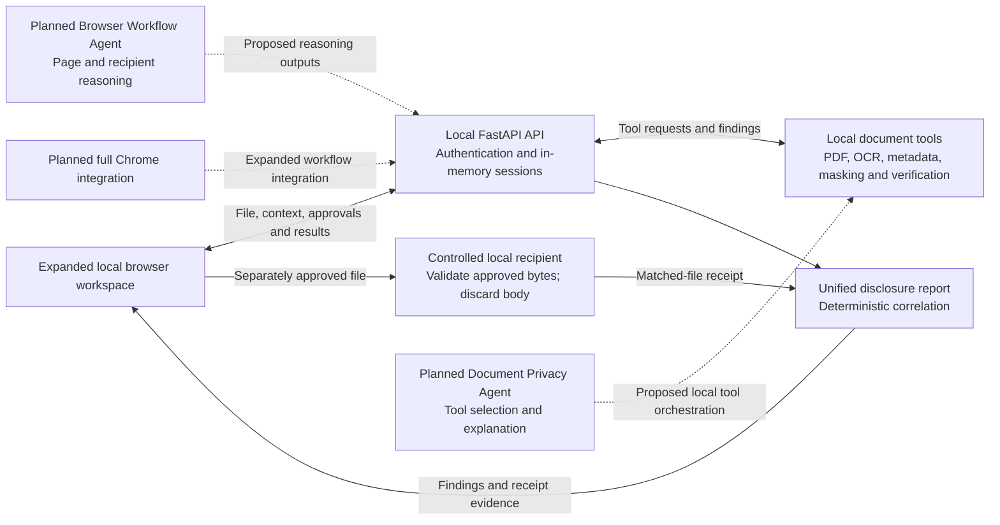

# PrivacyGate AI

**Know what you’re sharing. Know where it’s going.**

**Track 2 — Beyond the Browser: Reimagine How We Use the Web · wHACKiest 2026**

PrivacyGate AI is a local-first document privacy assistant designed to help people understand and control what they disclose during online uploads. It combines visible personal-information findings, supported hidden file details and upload-recipient information in one user-controlled review.

The intended product is a **Chrome extension backed by a local Python service**. The repository currently contains a basic masking extension and a separate, expanded local web workspace demonstrating metadata inspection, verified protection and actual approved uploads to local test recipients. Integrating that expanded workflow into Chrome is a planned next step.

## Problem and intended users

People share identity proofs, résumés, certificates and other personal documents through online services. A file can reveal more than its preview makes apparent:

- **Visible personal information:** full identifiers, phone numbers or email addresses that may exceed a task’s stated requirements.
- **Hidden file details:** properties such as a PDF’s author, creator or title that do not appear on its rendered page.
- **Recipient information:** the upload endpoint can differ from the website being viewed.

A PDF certificate can contain an author’s name in metadata even when that name is absent from the page. An identity document may expose contact details alongside the identifier needed for a task.

These disclosures are not automatically inappropriate. Recipients may require original documents, metadata is not inherently harmful, and a separate storage service can be legitimate. Users need evidence and understandable choices rather than an automatic safety verdict.

PrivacyGate targets individuals sharing personal files and organisations seeking clearer document-submission workflows. Its scope is not restricted to students or one application type.

## Solution and workflow

PrivacyGate asks: **What does this file reveal, where is it intended to go, and which actions does the user approve?**

1. **Select a supported document.** Extract native PDF text or use local OCR for scanned/image-based content.
2. **Review findings.** Inspect supported identifiers, hidden metadata, technical compatibility and authentication indicators.
3. **Review the intended recipient.** The controlled workspace shows the configured destination before submission.
4. **Approve protection.** Select findings to mask and explicitly approve the transformation. The practical protection operation includes supported metadata cleanup; metadata-only cleanup is available when applicable.
5. **Verify a separate copy.** Reopen the output and check approved changes, supported metadata removal, technical compatibility and original integrity. Required checks gate protected-file download and submission.
6. **Approve sending separately.** Choose the original or a verified protected copy and explicitly approve its upload to a local test recipient.
7. **Review the receipt.** The report adds the observed destination and evidence that received bytes match the approved file.

### Example: an identity PDF

The built-in synthetic identity PDF contains an Aadhaar-like identifier, contact information and planted author/creator/title properties. PrivacyGate reports supported findings and the configured recipient. The user approves selected masking and metadata removal, reviews the protected copy and verification result, and separately approves a test upload.

For the synthetic Aadhaar-like sample, `xxxx xxxx 0124` retains the final four digits. The sample is fictional. A custom-protected copy is **not an officially issued Masked Aadhaar**, and acceptance by a recipient is not guaranteed.

## Implementation status

| Capability | Status |
|---|---|
| Local single-page PDF/PNG/JPEG inspection | Implemented |
| Aadhaar-like, PAN-like, phone and email pattern detection | Implemented, with OCR/layout limitations |
| Approved masking and separate protected copies | Implemented for supported layouts |
| Output reopening, removal/rendering checks and download gates | Implemented |
| PDF properties/XMP-presence and readable image metadata inspection | Implemented in the expanded local workspace |
| Supported metadata cleanup and original-integrity checks | Implemented in the expanded local workspace |
| Same-origin and different-origin local uploads with receipts | Implemented in the expanded local workspace |
| Basic Chrome side panel, portal button and backend messaging | Implemented in the existing extension |
| Expanded metadata/recipient workflow inside Chrome | Planned integration |
| Request observation on additional supported websites | Planned; no general-site monitoring claim |
| Browser Workflow Agent and Document Privacy Agent using LLM reasoning | Planned; no current LLM inference |
| Reusable Web SDK and institutional integrations | Proposed |
| AWS hosting and ElevenLabs voice guidance | Optional proposals; not integrated |
| Pro subscriptions, SDK licensing and partnerships | Business hypotheses; not validated |

The implemented LangGraph components are deterministic document-processing and decision subgraphs, distinct from the proposed reasoning agents.

## Architecture

The expanded browser workspace communicates with an authenticated, loopback-only FastAPI service. Document tools run on the same computer. A configured local recipient receives an explicitly approved file and produces receipt evidence.



Solid connections represent the implemented local workflow; dashed connections represent planned additions. The earlier basic extension exists separately. The planned Chrome node refers to integrating the expanded workflow.

### Document processing

- **Extraction:** native PDF text on supported paths; local Tesseract OCR for scanned/image-based content.
- **Detection:** patterns and supporting checks identify candidate identifiers. Matches are findings for review, not identity verification or a complete sensitive-data inventory.
- **Protection:** PDF redaction removes supported source content before inserting readable masks; image processing changes actual pixels. Uncertain boundaries or backgrounds block protected output.
- **Metadata:** inspect standard PDF properties and XMP presence, readable EXIF tags and selected ancillary image fields. Inspection is not exhaustive.
- **Verification:** reopen the output, check selected target removal and replacement rendering, confirm retained Aadhaar digits, reinspect supported metadata, and check output format/size and original integrity.

Scanned/image-bearing PDFs are reconstructed without their original searchable text layer. Images are exported as fresh PNGs. Partial masks deliberately retain some information, which remains visible for the user to review.

### Recipient evidence and approval

The practical workspace uses a page/API on port `8765` and an optional separate local recipient on port `8766`. Same-origin and different-origin modes compare scheme, host and port.

The configured destination is shown before upload. Separate approval creates a **90-second, single-use grant** bound to the session, exact file SHA-256 digest, byte count, destination and page origin. The browser sends the selected file directly to that recipient. The receiver validates the grant and bytes, updates receipt evidence and discards the streamed body after hashing/counting it.

Observed destination evidence becomes available during the approved upload. It comes from the controlled portal and receiver, not arbitrary-site Chrome monitoring. A matching receipt does not establish an external recipient’s trustworthiness, future handling or deletion of a document.

## Technology stack

| Layer | Technology | Role and rationale |
|---|---|---|
| Extension interface | React, TypeScript | Findings, previews, user selections and typed messages |
| Extension build/platform | WXT, Chrome Manifest V3 | Packaging, content script, side panel and background service worker |
| Expanded local interface | HTML, JavaScript, CSS | Demonstrates the practical workflow before full extension integration |
| Backend | Python, FastAPI, Uvicorn, Pydantic | Authenticated local requests, validated input and session coordination |
| PDF engine | PyMuPDF | Extraction, properties, supported redaction, rendering and output reopening |
| OCR | Tesseract through pytesseract | Local scanned-text recognition with bounded calls |
| Images | Pillow, OpenCV, NumPy | Pixels, supported metadata, masking and QR indicators |
| Workflow | LangGraph and Python rules | Deterministic document steps; ordinary Python correlates recipient evidence |
| Storage | In-memory sessions | Temporary processing state without a document database |
| Verification | pytest, Node test runner | Document/workflow regressions and extension-worker authorisation checks |

The core runs on a CPU laptop with local dependencies; no GPU, paid inference API or LLM service is required. Tesseract uses OCR recognition models, while language-model reasoning is not implemented. Dependencies are listed in [requirements.txt](requirements.txt) and the [extension package](chrome-extension/package.json).

## Differentiation

PrivacyGate connects **document findings, recipient context, file-specific approval, verified protection and upload evidence** in one sharing workflow.

| Existing approach | Established capability | PrivacyGate’s connected focus |
|---|---|---|
| PDF editors | Redaction and supported PDF sanitisation | Connect protection choices to the upload review |
| Metadata inspectors | Find supported hidden file details | Combine findings with visible information and recipient context |
| Browser/network tools | Observe supported requests and destinations | Associate recipient evidence with the reviewed file and approval |

These categories overlap. PrivacyGate does not claim to invent OCR, redaction or metadata inspection, or to be the only product combining data and destination controls. Its proposed distinction needs evaluation through usability, accuracy and integration quality.

## Privacy and security

- Inspection, OCR, masking and verification run locally. The core does not send files or extracted text to cloud inference services.
- Servers bind to `127.0.0.1`. API endpoints, including `/health`, require the pairing token printed in the terminal. Host/origin checks supplement authentication.
- Extension permissions are restricted to the demo. The extension does not monitor unrelated browsing traffic, cookies or credentials.
- Sessions hold original/output bytes in process memory, expire after 15 minutes of inactivity and can be explicitly cleared. The current backend allows four sessions and one document-processing operation at a time.
- Parsing, multipart handling and OCR can use library-managed temporary files that their wrappers clean up. User-downloaded copies remain on the user’s device.
- Application handling avoids logging sensitive document values; LangSmith tracing is disabled around document processing. Production use still requires a security review.
- Originals remain unchanged. Protection and final submission need separate approval. Failed or incomplete required checks block protected output.
- Signature indicators block modification; detection is not cryptographic validation. QR detection neither verifies identity nor removes QR payloads.

## Verification and impact

### Recorded evidence

The [practical verification record](docs/practical-verification.md) reports **51 backend tests passed in 17.49 seconds** on Windows: nine practical-workflow tests and 42 existing regressions. This is recorded prototype evidence, not an accuracy score.

Browser demonstrations used actual synthetic file bytes for masking, metadata cleanup, original-integrity checks, scanned OCR and same-origin/different-origin receipts. Native file-picker automation stalled and is not marked browser-verified. Built-in samples exercise actual backend processing; a file saved by the browser’s download mechanism is not asserted by that record.

The [practical benchmark data](docs/practical-benchmarks.json) records three runs per synthetic fixture:

| Sample | Local API pipeline times |
|---|---|
| Text identity PDF | 180 ms, 141 ms, 147 ms |
| Scanned identity image | 1,234 ms, 1,144 ms, 1,203 ms |

The pipeline covers analysis, metadata inspection, protection, verification and download processing. It excludes browser rendering, user decisions and upload time. These samples do not establish production throughput, P95 latency, accuracy or a performance guarantee.

### Planned evaluation

| Outcome | Measurement |
|---|---|
| Find relevant information | Per-category precision/recall on labelled, representative documents |
| Protect approved details | Target-removal rate plus independent extraction/visual review |
| Preserve usefulness | Required-field retention and acceptance in supported recipient workflows |
| Improve sharing decisions | Correct interpretation of findings/recipient evidence, completion and review time against a baseline |
| Maintain responsiveness | Latency percentiles, memory use and failures by document type, size and device |

Pilot benefits, customer demand and large-scale performance remain unvalidated.

## Feasibility, scalability and risks

Established PDF/OCR/image tools and the existing masking engine support phased implementation. Native extraction avoids OCR where supported, while per-device processing reduces central compute and document-storage requirements. File-size, page-count, pixel-count, OCR-time and session limits bound the current workload.

Throughput remains limited by each device’s CPU and memory. The current service is stateful and serialises document processing; it is not a horizontally scaled multi-tenant backend. Multi-page support, bounded queues, secure updates and supported-site deployment need further engineering.

| Risk / boundary | Response or development requirement |
|---|---|
| Single-page PDF/PNG/JPEG scope | Reject unsupported input; add formats/pages after tests |
| OCR errors and missed patterns | Report coverage and uncertainty; a missing finding does not prove safety |
| Complex or unsupported PDF structures | Block unsupported protection rather than claim complete sanitisation |
| Uncertain masking boundaries/backgrounds | Block protected output when a reliable transformation cannot be established |
| Signature and QR mechanisms | Preserve originals, block modification on signature indicators and explain unchanged QR payloads |
| Recipient rejects a modified document | Check technical compatibility; validate actual acceptance with supported recipients |
| Immediate uploads, redirects and changing websites | Explicit controlled preflight now; future adapters need permission/compatibility testing |
| Malformed or hostile files | Existing type/resource limits are preliminary; production needs parser hardening and security testing |

The practical page sets a **2 MB portal limit**. The engine has a **10 MB maximum**, **one-page scope** and **20-million-pixel limit**; backend limits do not override portal requirements. An ordinary extension cannot guarantee universal interception or blocking of every upload.

The earlier `/portal` submission is simulated; `/practical` performs actual approved transfers to local recipients. [Known limitations](docs/known-limitations.md) covers processing and the earlier extension. [Practical verification](docs/practical-verification.md) describes the expanded workflow’s evidence and boundaries.

## Business model and roadmap

### Proposed business model

- **Individual users:** a freemium extension for essential protection, with possible Pro subscriptions for advanced features.
- **Organisations:** potential annual SDK licensing, usage-based plans, deployment support and custom integrations for recruitment platforms, universities, document-intake portals and software providers.
- **First users:** volunteer uploaders, including students and job seekers, and consenting portal teams. Pilots would assess usability, privacy-related outcomes and willingness to pay.
- **Costs:** development, document-tool maintenance, browser/site compatibility, security testing, distribution and support. Optional cloud/voice services add operating costs; local processing is not cost-free deployment.
- **Growth:** individual adoption, institutional pilots and tested platform partnerships. Pricing, serviceable market, revenue, customers and signed partnerships have not been validated.

### Planned development

1. Integrate the expanded metadata, protection and recipient report into the existing Chrome extension.
2. Add tested adapters for selected real upload workflows and improve permitted request/session correlation.
3. Expand document layouts, formats and page support with correctness and performance evaluation.
4. Add exactly two bounded reasoning agents: **Browser Workflow Agent** for page/recipient interpretation and **Document Privacy Agent** for local tool selection and explanations. Deterministic correlation remains ordinary code, not a third reasoning agent.
5. Develop a reusable **Web SDK** for consenting platforms to embed preflight review, approvals and supported output checks.
6. Add organisational policies, appropriate audit records, secure deployment/updates and support after pilot evidence.

### Optional AWS and ElevenLabs integration

AWS could host non-sensitive public demo assets and setup guidance. A future API Gateway/Lambda endpoint could deliver predefined voice instructions with the ElevenLabs credential stored server-side in Secrets Manager. ElevenLabs could generate opt-in generic guidance or pre-generated prompts.

Only fixed guidance identifiers or predefined non-sensitive text would enter that voice path; documents, filenames, extracted identifiers and detailed findings would remain outside it. AWS would not replace local document processing under this design. Neither integration is implemented.

## Quick start

Install Python 3.11+, Node.js 22.12+ with npm, and Tesseract with English data. Desktop Chrome is needed for the extension. Setup downloads dependencies; installed processing runs locally. Recorded verification is from Windows; macOS scripts are provided, with actual macOS runtime checks pending.

### Windows

From the repository root:

```powershell
winget install --id UB-Mannheim.TesseractOCR --exact
powershell -ExecutionPolicy Bypass -File .\setup.ps1
powershell -ExecutionPolicy Bypass -File .\start-practical.ps1
```

### macOS — device verification pending

With Python, Node.js and Homebrew installed, run from the repository root:

```sh
brew install tesseract
sh setup.sh
sh start-practical.sh
```

Open **http://127.0.0.1:8765/practical**, pair with the terminal token and try the synthetic identity PDF. Keep the terminal running; Ctrl+C stops both services. Detailed setup, extension loading, troubleshooting and test commands are in the [setup guide](docs/SETUP.md).

## Repository and resources

```text
backend/                Local API, document engine, OCR, masking and receipts
chrome-extension/       WXT/React side panel, worker and portal content script
prototype/practical/    Expanded local browser workspace
prototype/portal.*      Earlier portal with simulated submission
sample-documents/       Clearly labelled synthetic fixtures
tests/                  Document, workflow and authorisation checks
scripts/                Checkpoints, benchmarks and packaging
docs/                   Setup, evidence, limitations and narration
output/presentations/   PowerPoint decks
```

- [Setup and verification commands](docs/SETUP.md)
- [Practical verification](docs/practical-verification.md)
- [Benchmark data](docs/practical-benchmarks.json)
- [Known limitations](docs/known-limitations.md)
- [Platform checkpoints](docs/platform-checkpoints.md)
- [Project presentation](output/presentations/PrivacyGate-AI-Track2-Pitch.pptx)
- [Three-minute, three-presenter video script](docs/video-script-3min.md)

Recorded evidence demonstrates supported prototype behaviour. It does not certify complete anonymity, document authenticity, recipient trust or production readiness.
