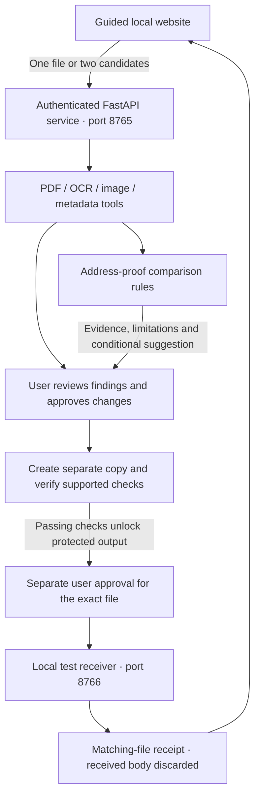

# PrivacyGate AI

**Review what you disclose before sharing a document.**

**wHACKiest 2026 · Track 2 — Beyond the Browser**

PrivacyGate AI is a local document-privacy prototype. It helps users inspect supported personal identifiers and metadata, compare two address-proof options, choose a document, approve changes, verify a separate protected copy and separately approve a controlled test upload.

The current working demo is a **local website backed by Python**. This repository also includes a **basic Chrome extension prototype**. The latest comparison, metadata and receiver-receipt workflow is implemented in the website; integrating all of it into the extension remains planned.

## The problem

A document can reveal more than its intended purpose requires. For example, both a bank statement and an electricity bill might satisfy an address-proof requirement, while the bank statement also exposes balances and transaction history. A PDF can also carry author or creator metadata that is absent from its page preview.

Less disclosure is useful only when the chosen document and its remaining information meet the recipient's requirements. A company may need the complete document, including details beyond the main ID number. **Information not mentioned on an upload page is not automatically unnecessary.**

PrivacyGate supports review and informed choices. It does not certify authenticity, complete privacy or acceptance by a recipient.

## What is implemented

| Capability | Current status |
|---|---|
| Single-page PDF, PNG and JPEG inspection | Implemented locally |
| Native PDF text extraction and English OCR for scans/images | Implemented |
| Aadhaar-like, PAN-like, phone and email pattern findings | Implemented with coverage limitations |
| PDF properties/XMP presence and supported image metadata checks | Implemented in the guided website |
| Two-document address-proof disclosure comparison | Implemented in the guided website using deterministic rules |
| Recipient acceptance and required name/address declarations | Explicitly confirmed by the user |
| Selected masking, supported metadata cleanup and separate output | Implemented for supported layouts |
| Output reopening, target/replacement checks and original integrity | Required for protected output |
| Original/protected previews and protected-copy download | Implemented |
| Separately approved local upload with a matching receiver receipt | Implemented |
| Basic Chrome side panel and local mock-portal integration | Implemented separately |
| General company-site integration and request observation | Planned; no arbitrary-site monitoring claim |
| Document-based form autofill | Planned |
| Two reasoning agents using an LLM | Planned; no current LLM inference |
| Organisational policy SDK, AWS and ElevenLabs | Proposed; not integrated |

LangGraph currently coordinates ordinary deterministic functions. The comparison itself is plain Python; no AI agent chooses the winning document.

## Guided prototype

The website has four stages:

1. **Choose a document or two address-proof candidates.** Use local files or built-in fictional samples.
2. **Review or compare findings.** Inspect previews, identifiers, metadata, extraction limitations and configured recipient information.
3. **Approve protection and verify.** Select supported identifiers, read the recipient-requirements notice, approve changes and inspect a separate verified copy.
4. **Approve the local test upload.** Review the exact variant and destination, approve sending separately and inspect the receipt.

All finding selections and approvals start unchecked. The unchanged original is an explicit alternative and is never labelled a verified protected copy.

### Example A: synthetic identity PDF

The sample contains an Aadhaar-like number, email, phone and planted PDF properties. The supported readable Aadhaar mask retains the final four digits, for example `xxxx xxxx 0124`.

The document is fictional. A custom-protected copy is **not UIDAI-issued Masked Aadhaar**. Modification is blocked when a signature indicator is detected; actual signature validity is not verified.

### Example B: bank statement versus electricity bill

Choose **Compare two address proofs**, then **Inspect bank statement + electricity bill**. Both fictional samples contain the same name and address.

The bank sample includes readable account information, balances and transaction rows. The utility sample includes consumer, usage and billing details. Users must declare recipient acceptance and confirm the required name/current address themselves before a suitable option can be recommended.

The address-proof policy compares **distinct detected category counts**, in order:

1. Government identifiers and financial activity/balances.
2. Account identifiers.
3. Contact and billing details.
4. Supported metadata fields.

The first differing tier determines the suggestion. Required name/address are excluded. Filenames and document-type labels do not determine the winner. Blank headings and explicitly masked financial values do not count as readable disclosure evidence.

Possible results include a conditional recommendation, an equal-policy-count tie, an inconclusive comparison, no confirmed option, or an only-confirmed-option result. The latter is not a privacy victory over an unconfirmed document. Uncertain extraction and uninspected possible QR contents prevent a reliable privacy ranking.

This is a **bounded heuristic policy**, not a universal privacy score. It has not been validated for arbitrary real-world layouts. Some comparison findings, such as transaction history, do not yet support automatic masking.

After choosing a candidate, the existing protection/upload flow uses that document. Changing a file or suitability declarations invalidates the comparison and downstream state. Switching documents clears protected-copy state, approvals and receipts.

## Architecture



Both HTTP services run on the same computer. The application uses in-memory sessions rather than a document database.

A separate WXT/React side-panel prototype talks to the same local engine for the earlier masking workflow. Its content script is restricted to the local mock portal.

### Processing and verification

- **PDFs:** extract native text and positions on supported paths; render scanned/image-bearing PDFs for OCR.
- **Images:** correct EXIF orientation and prepare pixels with Pillow; Tesseract returns text and character positions.
- **Detection:** patterns identify candidate identifiers and context-based comparison disclosures. Detection is not identity verification.
- **Masking:** permanently remove supported original content before inserting readable replacements. Uncertain character boundaries or backgrounds block output.
- **Metadata:** inspect standard PDF properties/XMP presence, readable EXIF and selected ancillary fields. These checks are not exhaustive.
- **Verification:** reopen output, check approved target removal and replacement rendering, supported last-four preservation, metadata removal, original integrity and output size/format compatibility.

Image outputs are fresh PNGs. Protected scanned PDFs are reconstructed without the original searchable text layer. Partial masks deliberately retain some information.

### What the receiver proves

The default receiving endpoint is `http://127.0.0.1:8766/mock-upload`; a same-origin test mode is also available.

Upload approval creates a 90-second, single-use grant tied to the session, file hash, byte count, destination and page origin. The browser sends the approved bytes directly to the selected local receiver. The receiver validates them, returns a receipt and discards the received body.

**The destination is configured for this demo.** It is not discovered through DevTools or `webRequest`. A receipt proves the controlled transfer matched the approved file; it does not prove recipient trust, external-company acceptance, subsequent deletion or later forwarding.

## Technology stack

| Technology | Role |
|---|---|
| HTML, CSS and JavaScript | Current guided website |
| WXT, React, TypeScript and Manifest V3 | Basic extension build, side panel, worker and content script |
| Python, FastAPI, Uvicorn and Pydantic | Local server, authenticated API and request validation |
| PyMuPDF | PDF extraction, previews, metadata, supported redaction and reopening |
| Tesseract / pytesseract | Local OCR for scans and images |
| Pillow / NumPy | Image preparation, readable masks and pixel checks |
| OpenCV | Possible QR detection and synthetic test-fixture generation |
| LangGraph / Python rules | Deterministic processing coordination and comparisons |
| SHA-256 and single-use grants | Correlation of the approved and received file |
| Python unittest/pytest and Node test runner | Backend, approval-state and extension-worker tests |

OpenCV currently does not perform OCR enhancement. Tesseract includes recognition models, but no LLM or reasoning agent is called. There is no required paid inference API or GPU.

The core currently requires a local Python/OCR installation. A streamlined companion installer or browser-only engine has not been built; installed development dependencies are not a final installer-size measurement.

## Privacy, safeguards and limits

- Local inspection, OCR, masking and verification do not send document data to cloud inference services.
- Servers bind to loopback. API calls, including health checks, require the random token printed at startup. Host and origin checks supplement authentication.
- The token changes on backend restart. The website keeps it only in page memory; the extension uses trusted session storage. Tokens are not committed to this repository.
- Sessions expire after 15 minutes of inactivity and can be cleared. The current service allows four sessions and serialises document processing.
- Documents are held in process memory; libraries may use temporary files cleaned by their wrappers. Downloaded copies remain on the user's device. This is not a forensic-erasure guarantee.
- Protected output requires explicit change approval and passing checks. Sending requires separate approval. A receiver receipt does not replace document verification.
- Signature indicators block modification. Possible QR contents remain unchanged and can contain additional information.
- The guided page accepts **one-page PDF/PNG/JPEG files up to 2 MB**. The engine also enforces a 10 MB processing ceiling and a 20-million-pixel image limit.
- Detection and ranking are limited to supported patterns and extraction coverage. Missing findings do not prove absence of sensitive information.
- Users must check recipient requirements before removing information. The notice is displayed immediately before protection consent.
- The interface includes labelled controls, visible keyboard focus, textual findings, responsive layouts and reduced-motion support. Full assistive-technology and WCAG validation are outstanding.
- Production use still needs parser hardening, security review, supported-site compatibility testing, secure updates and installation packaging.

The extension identity file contains a **public** manifest key and extension ID used to keep the local origin allowlist stable. It is not a private signing key or service credential.

## Run locally

Requirements: Python 3.11+, Node.js 22.12+ with npm, and Tesseract with English language data. Desktop Chrome is needed for the extension. Setup downloads dependencies; installed document processing runs locally.

### Windows PowerShell

From the repository root:

```powershell
winget install --id UB-Mannheim.TesseractOCR --exact
powershell -ExecutionPolicy Bypass -File .\setup.ps1
.\.venv\Scripts\python.exe -u -m backend.practical_server
```

### macOS

With Homebrew, Python and Node.js installed:

```sh
brew install tesseract
sh setup.sh
.venv/bin/python -u -m backend.practical_server
```

Open **http://127.0.0.1:8765/practical** and enter the token from that terminal. Keep the terminal open. **Ctrl+C stops both services.** Run only one backend instance; an address-in-use error means a process already occupies the ports. A token printed by a failed second instance does not authenticate the running instance.

Windows runtime checks are recorded. Actual macOS runtime verification remains pending.

For the existing extension, build it with the setup script, open `chrome://extensions`, enable Developer mode and load `chrome-extension/.output/chrome-mv3`. Open `http://127.0.0.1:8765/portal` for its controlled integration. This earlier portal simulates final submission; real local transfers belong to `/practical`.

Detailed instructions and troubleshooting: [docs/SETUP.md](docs/SETUP.md).

## Verification

Run backend tests:

```powershell
.\.venv\Scripts\python.exe -m unittest discover -s tests -p "test_*.py" -v
```

On macOS, use `.venv/bin/python`.

Build/type-check the extension before its worker harness:

```sh
cd chrome-extension
npm run compile
npm run build
cd ..
node --test tests/extension.test.mjs tests/practical-flow.test.mjs
node --test sites/privacygate-demo/scenario.test.mjs
```

Verification on 27 November 2026 passed **64 backend tests and 23 JavaScript tests**: 14 guided-state checks, 3 extension-worker checks and 6 earlier simulation checks. Extension TypeScript compilation and the production Chrome build also passed. Tests cover content-based ranking, acceptance declarations, ties, inconclusive results, stale-state invalidation, chosen-file upload matching and existing masking regressions.

Live browser checks exercised sample comparison, manually selected synthetic PDF files, replacement of an invalid candidate, conditional recommendations, selected-copy protection and matching local receipts. A narrow viewport was checked for reflow and horizontal overflow. These checks do not establish production accuracy or universal website compatibility.

See [the practical verification record](docs/practical-verification.md) and [known limitations](docs/known-limitations.md). Earlier benchmark records use synthetic fixtures and different scopes; they are not production throughput or accuracy claims.

## Product direction and business model

The proposed product combines an individual extension with an organisational SDK. A platform-supplied policy could define accepted document types, required fields and explicitly permitted masking; an individual extension would need to distinguish explicit, inferred, unknown and conflicting public requirements.

Potential revenue includes Pro features, SDK licensing, usage-based plans and integration support. Customer demand, pricing, acceptance benefits and commercial viability remain hypotheses requiring pilots. Measure detection precision/recall, missed disclosures, recommendation usefulness, review time and successful submissions before claiming impact.

Planned work includes full guided-flow extension integration, tested real-site adapters and destination observation, structured extraction/autofill, two bounded reasoning agents, multi-page support and a policy SDK. AI assistance would not replace explicit user approval or deterministic output verification.

Optional AWS hosting and ElevenLabs generic voice guidance are proposals only. They are not part of the current document-processing path.

## Repository layout

```text
backend/                       Local API, comparison, PDF/OCR engine and receiver
prototype/practical/           Current four-step website
chrome-extension/              Basic WXT/React extension source and lockfile
sample-documents/              Whitelisted synthetic test fixtures
tests/                         Backend, state and worker checks
scripts/                       Benchmarks, checkpoints and source packaging
docs/                          Setup, limitations and verification records
sites/privacygate-demo/dist/   Earlier static scenario simulation, without real processing
```

Built-in address-proof PDFs are generated by the backend; choose the paired samples in the website. The older static simulation is explicitly labelled and separate from the working local engine.

Local environments, build output, private notes, generated presentations, uploaded documents, tokens, credentials and temporary artifacts are excluded from Git. Only known synthetic fixtures and public extension icons are intentionally included.
